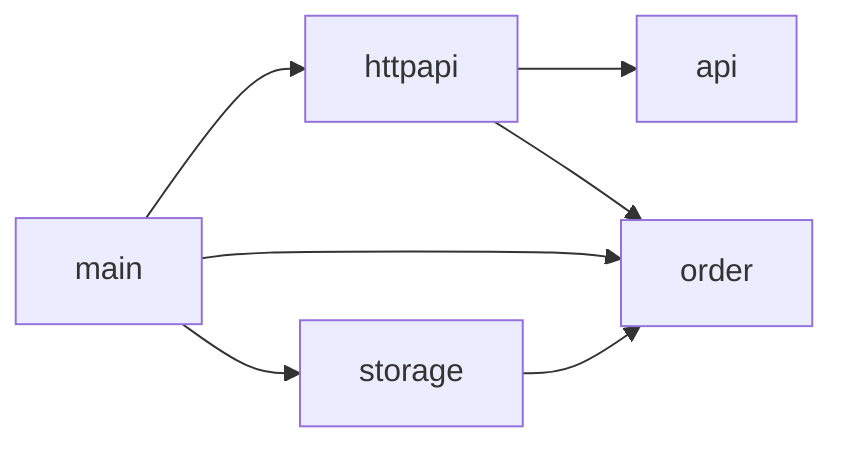

# Architecture

Allowed dependencies between components. This diagram is also a rule:
`mise run easement` reports every import between components that has no arrow
here. Tests may use every component except `main`.

| Component | Folder | Role |
|---|---|---|
| `main` | `cmd/orders` | wiring, config, server start and shutdown |
| `api` | `internal/api` | generated from `api/openapi.yaml`, never edited by hand |
| `httpapi` | `internal/httpapi` | HTTP layer: validation, handler, error bodies, access log |
| `order` | `internal/order` | domain: `Order`, `Service`, `Repository` interface |
| `storage` | `internal/storage` | `Repository` implementations |

The domain (`order`) depends on nothing in the project. `storage` implements
the `order.Repository` interface, so the arrow points from `storage` to `order`.
